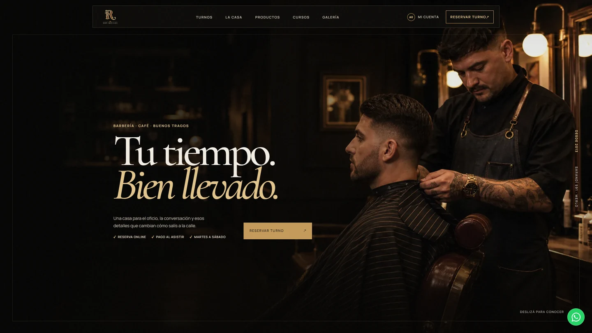
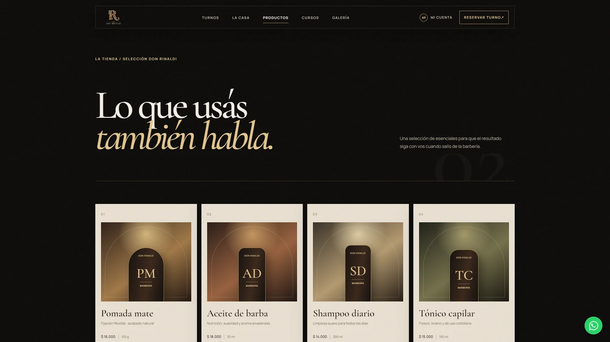

# Don Rinaldi

Sitio web y aplicación de turnos para una barbería, con catálogo y administración.

| Proyecto | Detalle |
|---|---|
| Tipo | Proyecto web para cliente |
| Estado | Sin puesta en producción |
| Tecnologías | Next.js · TypeScript · API HTTP · SQLite / adaptador D1 |
| Desarrollo | Agustin Crudo · Ingenia Software |
| Código de la aplicación | Privado |

## El problema

El proyecto combinaba dos necesidades: presentar la identidad, los servicios y los productos de la barbería, y resolver la disponibilidad y reserva de turnos con herramientas de administración.

## Qué desarrollé

- Sitio público con presentación del negocio, servicios, cursos y productos.
- Consulta de disponibilidad y reserva de turnos.
- Herramientas administrativas para gestionar la operación.
- Frontend y API con contratos y reglas compartidas.

## Mi trabajo

Diseñé y desarrollé la solución para el cliente, desde la presentación visual del sitio hasta los flujos de turnos y administración.

## Entrega del proyecto

El desarrollo reúne la web pública y la aplicación de turnos. Finalmente no llegó a ponerse en servidor por un motivo externo al proyecto.

## Video

[Ver o descargar el video MP4 · 21 s](assets/recorrido.mp4)

## Más capturas

**Propuesta de la barbería**

**Productos**

## Documentación técnica

- [Arquitectura](docs/arquitectura.md)
- [Decisiones técnicas](docs/decisiones-tecnicas.md)

## Contacto

[Portfolio](https://ingeniasoftwareok.github.io/portfolio/) · [Servicios de Ingenia](https://ingenia-software.com.ar/) · [Contacto personal](mailto:agustincrudo01@gmail.com)
