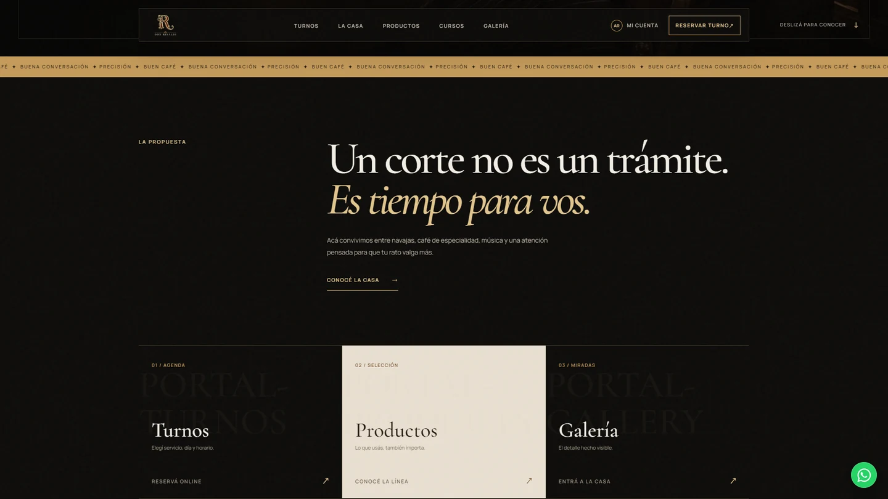

# Don Rinaldi

Identidad web y una aplicación de turnos desarrolladas para un cliente de barbería.

| Proyecto | Detalle |
|---|---|
| Tipo | Proyecto web para cliente |
| Estado | Desarrollo para cliente. Sin puesta en producción. |
| Tecnologías | Next.js · TypeScript · API HTTP · SQLite / adaptador D1 |
| Desarrollo | Agustin Crudo · Ingenia Software |
| Código de la aplicación | Privado; este repositorio presenta el caso |

**Material visual de demostración.** Las cifras de las pantallas no son resultados comerciales.

## Recorrido visual

[Ver o descargar el video MP4 · 21 s](assets/recorrido.mp4) · [Descripción del recorrido](docs/recorrido.md) · [Rótulos descriptivos VTT](assets/recorrido.es.vtt)

El video recorre la portada, la propuesta y los contenidos/productos. No muestra iniciar sesión, reservar, pagar o administrar. Es un recorrido visual del desarrollo, no una demostración funcional completa de turnos.

## El problema

Conectar la presentación del negocio con servicios, disponibilidad, reservas y herramientas de administración, manteniendo separadas la experiencia pública y las operaciones internas.

## La solución

- Experiencia visual para presentar la marca, sus servicios y sus productos.
- Frontend y API separados, con contratos y reglas compartidas.
- Implementación de disponibilidad, reservas y herramientas administrativas en el código del proyecto.

## Mi participación

Desarrollo de la solución web bajo Ingenia Software, con programación y herramientas de IA durante la implementación y las iteraciones. El trabajo combina presentación visual con flujos de aplicación.

## Resultado y estado

Se desarrolló la solución para el cliente y el proyecto quedó sin puesta en producción. El caso presenta la experiencia visual y la arquitectura del trabajo realizado.

## Decisiones y alcance

- [Arquitectura simplificada](docs/arquitectura.md)
- [Decisiones técnicas seleccionadas](docs/decisiones-tecnicas.md)
- [Qué demuestra el material y qué queda fuera](docs/alcance-evidencia.md)

Más capturas del proyecto

**Propuesta del negocio**

**Productos**

## Disponibilidad del código

Este repositorio contiene documentación y material audiovisual del caso. El código fuente de la aplicación se mantiene privado. Los diagramas son explicaciones simplificadas, no instrucciones de despliegue ni una distribución del sistema.

## Contacto

[Agustin Crudo · Ingenia Software](https://github.com/IngeniaSoftwareok) · [Portfolio](https://ingeniasoftwareok.github.io/portfolio/) · [Web profesional](https://ingenia-software.com.ar/) · [Email](mailto:ingeniasoftwareok@gmail.com)
