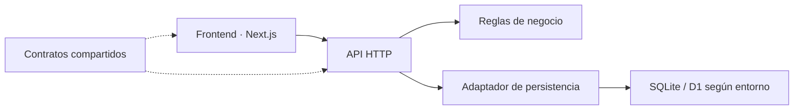

# Arquitectura del caso

El frontend no accede directamente a la base. La API aplica reglas y utiliza un adaptador de persistencia. Los contratos compartidos mantienen tipos e interfaces entre las partes.

El monorepo permite desplegar frontend y API por separado. Esta posibilidad técnica no significa que el proyecto se haya publicado: el desarrollo para cliente quedó sin puesta en producción.
