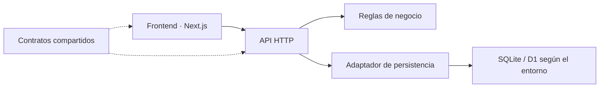

# Arquitectura

Organicé el proyecto en un monorepo con frontend, API y paquetes compartidos.

## Frontend

Next.js presenta el sitio y los flujos de la aplicación. Se comunica con la API para consultar información y enviar operaciones.

## API y persistencia

La API aplica las reglas de disponibilidad y reservas, y utiliza un adaptador para acceder a los datos. La persistencia contempla SQLite o D1 según el entorno.

## Paquetes compartidos

Los contratos, tipos y reglas comunes se mantienen en paquetes que utilizan ambas aplicaciones. El frontend y la API pueden desplegarse por separado.
